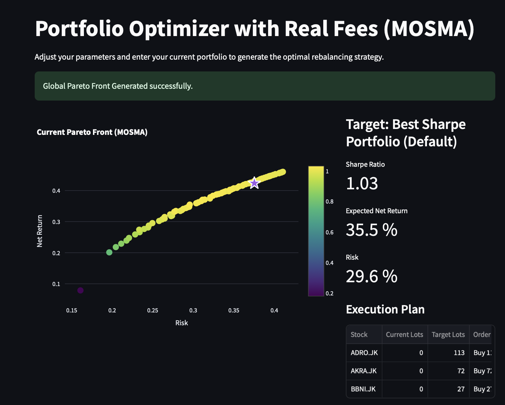

# Optimisation de portefeuille multi-objectifs sur la Bourse d'Indonésie (MOSMA)

Projet de recherche réalisé pendant mon stage de PRE (ENSTA Paris, été 2026) au département
P2MS de l'Institut Teknologi Bandung (ITB), sous la direction de Bouh Adhe.

L'objectif est un outil web (Streamlit) qui propose des portefeuilles d'actions **directement
exécutables** sur l'IDX :

- achat uniquement par **lots entiers** (1 lot = 100 actions) ;
- **frais asymétriques** (achat 0,15 %, vente 0,25 % par défaut) ;
- prise en compte du **portefeuille déjà détenu** : on ne paie que le rééquilibrage ;
- **front de Pareto** rendement/risque calculé par un *Multi-Objective Slime Mould Algorithm*
  (MOSMA), dont on sélectionne les points avec une logique NSGA-III ;
- portefeuille **hybride** qui passe de l'agressif au défensif selon le régime de marché (^JKSE) ;
- **backtest walk-forward** comparé à 1/N et à l'indice.

Le rapport de stage est dans [`docs/Rapport_PRE2026_BOURREE_JEAN-BAPTISTE.pdf`](docs/Rapport_PRE2026_BOURREE_JEAN-BAPTISTE.pdf).
**Le code a été corrigé après la remise du rapport** : voir la section [Corrections](#corrections-apportées-après-le-rapport).



## Structure

```
app.py                     Application Streamlit
mosma.py                   MOSMA (classement NSGA-II, archive, sélection NSGA-III, hypervolume)
backtest.py                Candidats, indicateur de régime, backtest walk-forward, métriques
utils.py                   Données (yfinance), covariance Ledoit-Wolf, frais, conversion poids -> lots
research/
  classic_backtests.py     Backtests du rapport (ch. 4-5) : Markowitz, HRP, Top-K, 1/N, hybrides
  lstm_prediction.py       Expérience LSTM (ch. 8), avec comparaison à la prédiction naïve
docs/
  Rapport_PRE2026_...pdf   Rapport de stage
  figures/                 Figures du rapport et captures de l'application
```

## Lancer l'application

```bash
python -m venv .venv && source .venv/bin/activate
pip install -r requirements.txt
streamlit run app.py
```

Les scripts de `research/` demandent en plus `pip install -r requirements-research.txt`.

## Méthode (version corrigée)

1. **Estimation** : rendements moyens annualisés et covariance **Ledoit-Wolf** sur une fenêtre
   glissante (1 à 3 ans, 2 par défaut).
2. **MOSMA** : chaque individu est un vecteur de poids continu (génotype). Avant d'être évalué,
   il est converti en **lots entiers** par `weights_to_lots` (arrondi inférieur, puis achats
   gloutons tant que le cash, frais compris, et le poids maximum le permettent). Les deux
   objectifs (−rendement net de frais, volatilité) sont donc calculés **sur le portefeuille
   réellement achetable**, cash résiduel inclus.
   La population est classée façon NSGA-II (fronts non dominés, puis distance de congestion).
   Les poids adaptatifs `W`, la probabilité `p` et les oscillations `vb` et `vc` suivent le SMA
   de Li et al. (2020). Une archive externe conserve les solutions non dominées.
3. **Sélection finale** : des directions de référence **uniformément espacées** (niching
   NSGA-III) donnent un front régulier.
4. **Arrêt** : soit un nombre fixe d'itérations, soit un plateau de l'**hypervolume 2D exact**
   (point de référence fixe).
5. **Hybride** : `w = (1 − α)·w_MaxReturn + α·w_MinRisk`. α vaut 0,1 quand ^JKSE est au-dessus
   de sa moyenne + 0,5σ sur la fenêtre (tendance haussière), 0,8 quand il est en dessous de
   moyenne − 0,5σ (tendance baissière), et 0,5 sinon.
6. **Backtest** : on part du cash et on rééquilibre environ une fois par mois, quelle que soit la
   fréquence des données. Seules les données passées sont utilisées. Lots, cash et frais sont
   suivis séparément pour chaque stratégie, et le cash ne devient jamais négatif. Métriques :
   rendement total, CAGR, volatilité, Sharpe, drawdown maximum, VaR 95 %, frais payés.

Le paramètre `seed` rend les résultats reproductibles.

## Corrections apportées après le rapport

La relecture du code a montré plusieurs écarts avec le rapport. Les versions d'origine ne sont
pas publiées, mais tout est décrit ici.

### Écarts entre le code et le rapport

| # | Problème dans le code d'origine | Correction |
|---|---|---|
| 1 | **α était inversé** : le code renvoyait α = 0,8 (80 % défensif) en marché haussier et 0,1 en marché baissier. C'est l'inverse des chapitres 5 et 7.3, et l'interprétation de la Fig. 7.4 (α = 0,10 « marché haussier ») ne correspondait pas au code. | Le sens suit maintenant le rapport. `regime_switch(..., contrarian=True)` reproduit l'ancien comportement. |
| 2 | **Pas vraiment discret** : MOSMA optimisait des poids continus puis arrondissait à l'inférieur, ce que le rapport reproche justement à Markowitz. Seuls les frais étaient calculés sur les lots. | Les objectifs sont évalués sur les lots réellement achetés (génotype continu → phénotype discret). |
| 3 | **« NSGA-II »** : aucune distance de congestion. Le classement utilisait la somme `−rendement + risque`. | Vrai classement NSGA-II (fronts + distance de congestion) et archive tronquée par la distance de congestion. |
| 4 | **« NSGA-III »** : directions de référence non uniformes (`t**0.4`, alors que le rapport les dit « parfaitement équidistantes »). | Directions uniformes (`linspace`). |
| 5 | **« Hypervolume Plateau »** : en réalité l'aire de la boîte englobante de l'archive. | Hypervolume 2D exact avec point de référence fixe. |
| 6 | **SMA** : `vc` restait dans [−1, 1] au lieu de décroître ; pas de graine aléatoire. | `vc ∈ [−b, b]` avec `b = 1 − t/T` ; paramètre `seed`. |
| 7 | **Backtests de recherche sans frais**, alors que la section 4.2 affirme qu'ils sont prélevés. | Frais prélevés à chaque rééquilibrage (rotation × frais). |

### Méthodologie du backtest et des données

| # | Problème dans le code d'origine | Correction |
|---|---|---|
| 8 | **Fenêtre de 12 périodes quelle que soit la fréquence** (12 jours en journalier) et rééquilibrage à chaque période (≈ 1 200 optimisations en journalier). | Fenêtre exprimée en années et rééquilibrage mensuel. |
| 9 | **Covariance empirique** sur 11 rendements pour jusqu'à 30 actifs, donc singulière ou instable. | Shrinkage Ledoit-Wolf. |
| 10 | **Prix ajustés des dividendes** (défaut de yfinance) : nombre de lots faux dans l'historique, et comparaison biaisée avec ^JKSE, qui est un indice de prix. | Prix non ajustés des dividendes (`auto_adjust=False`), cohérents avec ^JKSE. |
| 11 | **Une seule position commune** : les quatre stratégies réutilisaient les candidats calculés avec la richesse et la position du Hybride. | Chaque stratégie se rééquilibre depuis sa propre position. |
| 12 | **Cash négatif possible** quand les frais dépassaient le reliquat. | L'allocation garantit un cash ≥ 0. |
| 13 | **α différent entre l'app et le backtest** : l'app utilisait la moyenne sur 5 ans, le backtest 12 périodes. | Même fenêtre partout. |
| 14 | **Markowitz (recherche)** recevait des rendements journaliers avec le taux sans risque par défaut de la bibliothèque. C'est sans effet avec PyPortfolioOpt ≥ 1.6, mais avec la 1.5.x `max_sharpe` échoue et le `except: pass` laisse le portefeuille en cash. | Moments annualisés, taux sans risque explicite, avertissement en cas d'échec. |

### LSTM et application

| # | Problème dans le code d'origine | Correction |
|---|---|---|
| 15 | **LSTM** : scaler ajusté sur toutes les données (fuite vers le test), `bfill` qui recopie des prix futurs, aucune baseline, 20 epochs fixes. | Scaler ajusté sur l'entraînement seul, pas de `bfill`, comparaison à la marche aléatoire, early stopping, graines fixées. |
| 16 | **App** : plantage si aucun portefeuille n'est valide ; un clic sur l'étoile sélectionnait le portefeuille n°0 ; le backtest était relancé à chaque clic ; les paramètres de l'algorithme n'étaient pas transmis au backtest. | Tous corrigés. |

### Ce que donnent les expériences corrigées

Résultats obtenus le 6 novembre 2026.

**LSTM (ADRO.JK)** : le modèle fait **moins bien** que la prédiction naïve « demain = aujourd'hui ».

| Mesure | LSTM | Naïf |
|---|---|---|
| MAPE sur 60 jours | 2,96 % | 1,80 % |
| MAE du rendement journalier | 2,47 % | 1,76 % |
| Bon sens de variation | 48,5 % | — |

Le MAPE de 2,31 % cité dans le rapport ne montrait donc pas de pouvoir prédictif : la courbe
« décalée d'un jour » est exactement le comportement de la prédiction naïve.

**Backtest** : 8 actions par défaut, données mensuelles, fenêtre de 2 ans, période 10/2023 → 11/2026.

| Stratégie | Rendement total | Drawdown max |
|---|---|---|
| Hybride (MOSMA) | −18,9 % | −35,9 % |
| 1/N | −17,3 % | −32,9 % |
| ^JKSE | −25,2 % | −41,6 % |
| Max Return | −45,2 % | −50,6 % |
| Hybride, α inversé (code d'origine) | −44,4 % | −47,4 % |

Ces résultats changent fortement avec l'univers d'actifs (retirer une seule action change le
classement), la période et la graine. Le +60 % du rapport ne doit donc pas être lu comme une
performance attendue.

## Limites connues

- **Biais du survivant** : l'univers est l'IDX30 actuel (voir le rapport, section 9.2).
- **Un seul chemin historique** : aucun test de significativité entre stratégies. Le rendement
  espéré est une moyenne historique bruitée, pas une prévision.
- **Dividendes ignorés** : stratégies et indice sont mesurés sur les prix seuls.
- **Frais dans l'objectif** : ils y sont comptés comme un coût ponctuel du rééquilibrage
  courant, alors qu'un rééquilibrage mensuel les paie environ 12 fois par an.
- **Seuils du régime** (0,5σ ; 0,1 / 0,5 / 0,8) : fixés à la main, non optimisés hors échantillon.

*Prototype de recherche, pas un conseil en investissement.*
