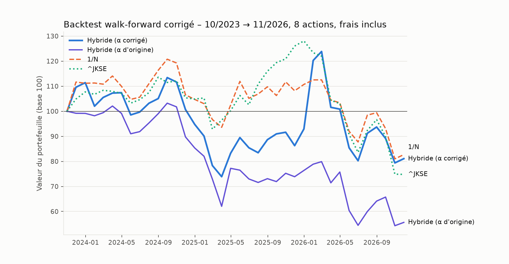
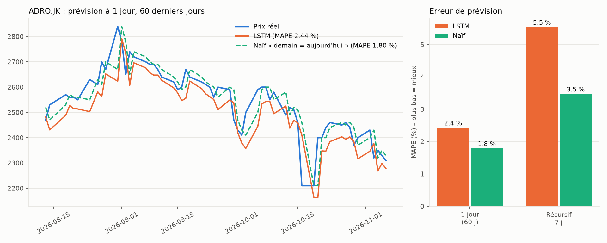

# Faiblesses des modèles

Cette page fait le point, modèle par modèle, sur ce que chaque approche suppose, où elle casse,
et ce que les tests ont montré. Elle complète le rapport de stage (section 9.2, biais du
survivant), qui ne couvrait qu'une partie de ces limites.

Pour chaque modèle :

- **Hypothèses** : ce que le modèle suppose vrai.
- **Où ça casse** : les situations où ces hypothèses tombent.
- **Observé** : ce qu'on a mesuré, et ce qui a été corrigé ou non.

Sommaire :

1. [Markowitz (moyenne-variance)](#1-markowitz-moyenne-variance)
2. [Algorithme génétique](#2-algorithme-génétique)
3. [MOSMA (Slime Mould multi-objectifs)](#3-mosma-slime-mould-multi-objectifs)
4. [Sélection NSGA-II / NSGA-III](#4-sélection-nsga-ii--nsga-iii)
5. [Stratégie hybride et indicateur de régime](#5-stratégie-hybride-et-indicateur-de-régime)
6. [Modèle de frais](#6-modèle-de-frais)
7. [Backtest](#7-backtest)
8. [LSTM](#8-lstm)
9. [Application web](#9-application-web)

---

## 1. Markowitz (moyenne-variance)

**Hypothèses**
- Les rendements futurs ressemblent à la moyenne historique de la fenêtre.
- Le risque se résume à la variance.
- Les poids sont continus.

**Où ça casse**
- **Erreur d'estimation.** La moyenne des rendements sur 1 ou 2 ans est extrêmement bruitée.
  L'optimiseur la traite pourtant comme exacte, et concentre le capital sur les actifs dont la
  moyenne est surestimée par hasard. Michaud parle d'*error maximization*.
- **Covariance mal conditionnée.** Avec 30 actifs et 12 à 24 points mensuels, la matrice
  empirique est singulière ou presque, et les poids optimaux deviennent instables.
- **Arrondi en lots.** Sur l'IDX (lots de 100 actions), arrondir les poids continus fait sortir
  le portefeuille de la frontière. L'écart est d'autant plus grand que le budget est petit par
  rapport au prix d'un lot.
- **Inertie** (rapport, section 2.1.2). Une fenêtre longue réagit tard aux retournements. C'est
  une limite du choix de l'estimateur, pas de Markowitz lui-même : une moyenne pondérée
  exponentiellement ou un shrinkage atténueraient le problème.

**Observé**
- Dans la version corrigée, la covariance passe par un **shrinkage Ledoit-Wolf**.
- Les rendements espérés restent de simples moyennes historiques : c'est la principale source
  de fragilité restante.

## 2. Algorithme génétique

**Hypothèses**
- Un croisement et une mutation sur des vecteurs de lots, avec pénalité de budget, finissent
  par converger vers le front de Pareto.

**Où ça casse**
- **Contraintes par pénalité.** Elles produisent beaucoup d'individus infaisables, et le
  résultat dépend du poids donné à la pénalité.
- **Lenteur.** Environ 3 minutes de calcul pour un front irrégulier (rapport, Fig. 6.1).

**Observé**
- Ce code n'est pas dans le dépôt. La figure du rapport est conservée dans
  [`figures/fig_ga_frontier.png`](figures/fig_ga_frontier.png).

## 3. MOSMA (Slime Mould multi-objectifs)

**Hypothèses**
- La métaheuristique explore assez l'espace pour approcher le vrai front discret.

**Où ça casse**
- **Aucune garantie d'optimalité.** Le front trouvé est une approximation qui dépend de la
  population, du nombre d'itérations et de la graine aléatoire. Pour 2 objectifs et quelques
  dizaines d'actifs, un solveur exact (programmation quadratique en nombres entiers) donnerait
  une référence. Elle n'a pas été calculée.
- **Hyperparamètres non calibrés.** z = 0,03, taille de population, taille d'archive : ces
  valeurs n'ont pas fait l'objet d'une étude de sensibilité.
- **Représentation génotype → lots.** Les individus évoluent dans l'espace continu des poids,
  puis un allocateur glouton les convertit en lots. Deux génotypes différents peuvent donner le
  même portefeuille, ce qui gaspille une partie des évaluations.
- **Intérêt par rapport à des méthodes plus simples non démontré.** On n'a comparé MOSMA ni à
  NSGA-II « pur », ni à une recherche aléatoire, ni à un solveur exact.

**Observé (et corrigé)**
- Dans le code d'origine, MOSMA optimisait des poids continus et n'arrondissait qu'à la fin.
  Il souffrait donc du même défaut que celui reproché à Markowitz. Les objectifs sont
  maintenant évalués sur les lots réellement achetés.
- Sur des données synthétiques, aucun des 3 000 portefeuilles aléatoires testés ne domine un
  point du front trouvé. C'est un contrôle de cohérence, pas une preuve d'optimalité.

## 4. Sélection NSGA-II / NSGA-III

**Hypothèses**
- Un classement par dominance et une sélection par directions de référence donnent un front
  régulier.

**Où ça casse**
- **NSGA-III est surdimensionné ici.** Il a été conçu pour 3 objectifs ou plus. Avec 2
  objectifs, la distance de congestion de NSGA-II suffit en général. Ici, NSGA-III ne sert
  qu'à répartir les points affichés à l'utilisateur.
- **Effet de la normalisation.** La sélection finale dépend de la normalisation par les bornes
  de l'archive : un point extrême isolé déforme la répartition.

**Observé (et corrigé)**
- Le code d'origine n'avait ni distance de congestion, ni directions de référence uniformes, ni
  véritable hypervolume, contrairement à ce que dit le rapport (voir [ERRATA](ERRATA.md)).

## 5. Stratégie hybride et indicateur de régime

**Hypothèses**
- Comparer le niveau de l'indice ^JKSE à sa moyenne glissante permet de détecter le régime de
  marché.
- Être agressif en tendance haussière et défensif en tendance baissière améliore le couple
  rendement/risque.

**Où ça casse**
- **Signal en retard.** Il est construit sur une moyenne des niveaux passés : il bascule
  *après* le début d'une chute, donc souvent au plus bas.
- **Paramètres arbitraires.** Les seuils (0,5 σ) et les valeurs d'α (0,1 / 0,5 / 0,8) ont été
  fixés à la main. Pire, s'ils avaient été choisis en regardant le backtest, celui-ci serait
  optimiste (*data snooping*).
- **Trois états seulement.** Le passage de 0,1 à 0,8 provoque des rééquilibrages brutaux, donc
  des frais.
- **Mélange des extrêmes.** Le portefeuille « Max Return » du front est en général concentré
  sur 1 ou 2 actions (92 % sur ADRO.JK dans le rapport), et l'hybride hérite de cette
  concentration.

**Observé**
- **Le code d'origine inversait α** : 80 % défensif en hausse, 90 % agressif en baisse. Les
  chiffres du rapport, dont le +60 %, ont été obtenus avec ce sens inversé.
- Sur la période 10/2023 → 11/2026, la version corrigée fait −18,9 %, contre −44,4 % avec le
  sens d'origine. Elle ne bat ni 1/N (−17,3 %) ni ne gagne de l'argent : elle limite seulement
  la casse par rapport à ^JKSE (−25,2 %).

## 6. Modèle de frais

**Hypothèses**
- Les coûts se limitent à des frais proportionnels (0,15 % à l'achat, 0,25 % à la vente).

**Où ça casse**
- **Coûts ignorés.** Le spread, l'impact de marché et les frais minimaux par ordre ne sont pas
  modélisés. Les ordres sont supposés exécutés au cours de clôture.
- **Mélange des horizons dans l'objectif.** Le coût ponctuel du rééquilibrage est soustrait d'un
  rendement *annualisé*. Avec un rééquilibrage mensuel, ces frais sont payés environ 12 fois
  par an : l'objectif les sous-pondère.

**Observé**
- Dans le backtest, les frais réellement payés sont comptés et affichés pour chaque stratégie.
- Le décalage d'horizon dans l'objectif n'est pas corrigé.

## 7. Backtest

**Hypothèses**
- La performance passée sur l'univers actuel renseigne sur la performance future.

**Où ça casse**
- **Biais du survivant.** L'univers est l'IDX30 d'aujourd'hui : on n'a gardé que les gagnants
  (rapport, section 9.2).
- **Un seul chemin historique, aucun test statistique.** Sur 3 ans de données mensuelles (37
  points), les écarts entre stratégies ne sont pas significatifs. Il faudrait au minimum un
  bootstrap par blocs ou un test de Diebold-Mariano sur les rendements.
- **Grande sensibilité aux choix.** Ajouter ou retirer **une** action de l'univers change le
  classement des stratégies : la stratégie Min Risk passait de +8 % à −23 % selon qu'AMRT.JK
  était présente ou non. Fenêtre, période et graine jouent aussi.
- **Dividendes ignorés.** Ils manquent aussi bien aux stratégies qu'à l'indice. Pour des
  valeurs à fort dividende comme ADRO ou PTBA, c'est loin d'être négligeable.
- **Pas d'analyse de sensibilité.** Le backtest n'a pas été relancé avec d'autres valeurs des
  paramètres (seuils du régime, fenêtre, poids maximum).

**Observé (et corrigé)**
- Prix ajustés des dividendes, fenêtre de 12 jours en journalier, position commune à toutes
  les stratégies, cash négatif possible, backtests de recherche sans frais : tous ces points
  sont corrigés (voir [ERRATA](ERRATA.md)).

## 8. LSTM

**Hypothèses**
- 30 jours de prix et d'indicateurs techniques contiennent une information exploitable sur le
  rendement du lendemain.

**Où ça casse**
- **Rendements journaliers proches d'une marche aléatoire.** Le rapport signal/bruit est très
  faible.
- **Métrique trompeuse sans référence.** Un MAPE calculé sur le *prix* paraît bon (2 à 3 %)
  simplement parce que le prix varie peu d'un jour à l'autre. Il faut le comparer à la
  prédiction naïve « demain = aujourd'hui ».
- **Prédiction récursive.** Les erreurs s'accumulent. Dans le code, les autres variables
  (prix des 29 autres actions, indicateurs) restent figées à leur dernière valeur, ce qui est
  une simplification forte.
- **Un seul titre, une seule période, aucune validation croisée temporelle.**

**Observé**
- Le LSTM fait **moins bien que la prédiction naïve** : MAPE de 2,4 à 3,0 % selon les
  exécutions, contre 1,8 % pour le naïf. Il trouve le bon sens de variation dans environ 50 %
  des cas, soit le hasard.
- La courbe « qui suit le prix réel avec un jour de retard » décrite dans le rapport est
  exactement le comportement de la prédiction naïve. Il est donc justifié de ne pas avoir
  intégré le LSTM au site (rapport, section 8.4), mais le MAPE de 2,31 % ne prouvait pas un
  pouvoir prédictif.

## 9. Application web

- **Rendement espéré trompeur.** Le « rendement net espéré » affiché est une moyenne
  historique annualisée, pas une prévision. Un chiffre comme 37 % par an n'a pas de valeur
  prédictive.
- **Cash sans rendement.** Le cash restant est supposé rapporter 0 %, alors que le Sharpe est
  calculé avec un taux sans risque de 5 %. Le portefeuille de risque minimum peut donc contenir
  jusqu'à 25 % de cash.
- **Dépendance à Yahoo Finance.** Les téléchargements échouent parfois pour une action
  (retirée de l'analyse, avec un avertissement). Aucune donnée officielle de l'IDX n'est
  utilisée.
- **Temps de calcul.** Le backtest relance MOSMA à chaque rééquilibrage, soit quelques dizaines
  de secondes avec les réglages par défaut.
